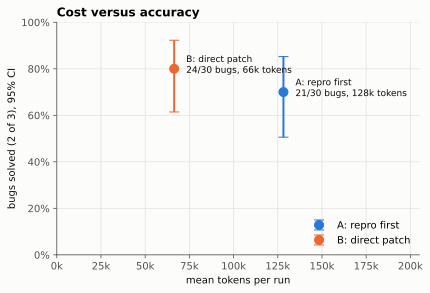
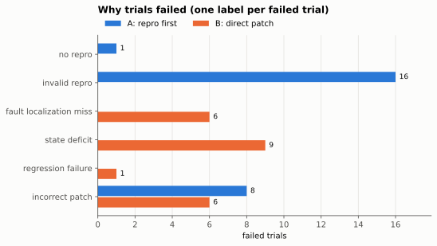
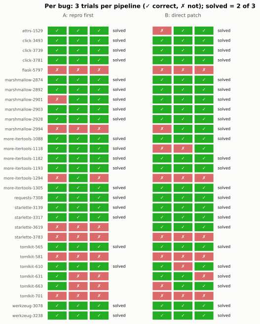

# Results

Final run `final-935ffcd2-v2-claude-sonnet-5-5-cli2.1.308`: Claude Sonnet 5.5 through the Claude
CLI, 30 test bugs from 9 Python libraries, both pipelines, 3 trials each (180 runs), harness and
prompts frozen at the `m3-freeze` tag. Every number here comes from `make analyze`
(`results/tables.md`, `results/numbers.json`), which rebuilds them from the committed per-trial
results with no model, no Docker and no keys. Analyses follow the plan fixed before the run
(`docs/ANALYSIS_PLAN.md`): they are exploratory, intervals are 95%, and with 30 bugs only large
differences could be detected.

## Headline

**Given only a synthetic crash report and the library's source, Claude Sonnet 5.5 fixed 21 of
30 real bugs when asked to reproduce the crash first (Pipeline A) and 24 of 30 when asked to
patch directly (Pipeline B).** The difference is not statistically reliable (exact McNemar
p = 0.375; the bugs split 1 to 4). Patching directly cost about half the tokens.

## Primary comparison: patch accuracy (H1)

A bug counts as solved when at least 2 of its 3 trials are graded correct.

| | Pipeline A (repro first) | Pipeline B (direct patch) |
|---|---|---|
| Bugs solved | 21/30 (70%; CI 51% to 85%) | 24/30 (80%; CI 61% to 92%) |
| Trials correct | 65/90 | 68/90 |

- Solved by both: 20; by neither: 5.
- Solved by A only: 1 (more-itertools-1118).
- Solved by B only: 4 (marshmallow-2994, starlette-3619, tomlkit-631, tomlkit-663).
- Paired difference in per-bug success rate, A minus B: **−0.033** (bootstrap CI −0.144 to
  +0.067). The interval includes zero.

**Reading:** this study finds no evidence that writing a reproduction test first improves
patching, and no evidence that it hurts. A real difference of 10 to 15 points would be
plausible under these intervals, so the question stays open at this sample size.

## Secondary measures

| | Pipeline A | Pipeline B |
|---|---|---|
| pass@3 (any trial correct) | 24/30 | 25/30 |
| Consistency (all 3 correct) | 20/30 | 19/30 |
| Repro test valid (repro oracle), per run | 71/90 (79%) | n/a |
| Repro test valid, bugs (2 of 3) | 24/30 (80%) | n/a |
| Tokens per run, mean / median / max | 128k / 141k / 313k | 66k / 73k / 185k |
| Model calls per run | 2.13 | 1.10 |
| Agent time per run, mean | 27 s | 18 s |
| Correct patches, lines changed (median) | 4 | 4 |

The run used 17.5 million tokens and 291 model calls through the owner's Claude plan. The CLI's
list-price estimate is about $45 ($33.42 for A, $11.42 for B), but no money was spent per call.
The largest run used 313k tokens, under the per-run cap of 400,000.

## Why runs failed (H2)

Each failed run has exactly one label (spec §8). State Deficit was assigned by hand during the
audit.

| label | Pipeline A | Pipeline B |
|---|---|---|
| no_repro | 1 | n/a |
| invalid_repro | 16 | n/a |
| fault_localization_miss | 0 | 6 |
| state_deficit | 0 | 9 |
| regression_failure | 0 | 1 |
| incorrect_patch | 8 | 6 |
| scope_violation, syntax_or_import_error, tampered | 0 | 0 |
| **failed runs** | 25 | 22 |

- **Pipeline B fails mostly for lack of information: 15 of 22 failures.**
  - In 6, the code that needed changing was never shown (`fault_localization_miss`).
  - In 9, the crash report lacks a deciding fact, such as settings hidden inside an object or
    an earlier call that produced the bad input (`state_deficit`).
  - No run broke the output format, failed to apply, or touched anything outside the library.
- **Pipeline A fails mostly at the reproduction step: 17 of 25 failures.**
  - In 16 runs, A's own check accepted its test, but the independent repro oracle rejected it:
    the test raised the wrong exception or failed in the wrong place, or it also failed on the
    maintainers' fix.
  - A fails 9 bugs. 5 of them are bugs where the crash report lacks a deciding fact or the
    code to change was not shown (flask-5797, marshmallow-2994, more-itertools-1294,
    tomlkit-581, tomlkit-701), and 2 more are tomlkit bugs (see the cohort section).
  - A reproduction test cannot supply information the crash report does not contain.
- **H2 ("missing context outnumbers syntax and tooling failures") holds clearly for Pipeline B.**
  For Pipeline A, the dominant failure is the repro stage itself.

## By bug kind and by contamination cohort (descriptive only)

| | Pipeline A | Pipeline B |
|---|---|---|
| `python_failure` (18 bugs) | 13/18 | 15/18 |
| `library_raise` (12 bugs) | 8/12 | 9/12 |
| fixed before the model's training cutoff (16) | 15/16 | 14/16 |
| fixed after it (14) | 6/14 | 10/14 |

- **Bug kind** makes little difference: a crash inside Python itself is fixed about as often as
  an error the library raises on purpose on valid input.
- **The cohort split is the largest difference in the study, but it cannot be read as
  contamination.**
  - Bugs fixed after June 2026 (the model's stated training cutoff) are solved less often,
    especially by Pipeline A.
  - However, the late cohort is not like the early one: all 6 tomlkit bugs fall in it, and
    tomlkit accounts for 4 of A's 8 post-cutoff failures.
  - Library, bug age and difficulty are mixed together here, and the plan rules out a test.
  - **What it suggests:** early bugs are easy for both pipelines (29 of 32 bug-pipeline pairs
    solved), so a benchmark built only from older fixes would overstate what these agents can
    do.

## Per bug

The full table is in `results/per_bug.csv` and `results/tables.md`.

## How far to trust the grader (manual audit, `docs/AUDIT.md`)

- **Fixes graded correct: none cheated.** All 133 were reviewed (79 distinct patches).
  - None special-cases tests, hides the error or touches anything outside the library.
  - 35 trials (26%) differ from the maintainers' fix in a way worth noting: a different but
    valid approach, a narrower fix (the reported crash is fixed, but a related case the
    maintainers also handled is not), or in one case a symptom-level fix.
  - "Correct" therefore means the crash is fixed without breaking the baseline, not that the
    patch matches upstream.
- **Fixes graded incorrect: a few were probably valid.**
  - In a random sample of 12 of the 46 rejected patches, the first pass found 2 real fixes the
    tests were too strict about (an exact error message, and a new equality rule). That is a
    false-negative rate of **17% (CI 2% to 48%)**.
  - The owner, as second reviewer, judged one of the two as rightly rejected, which gives
    **8% (CI 0.2% to 38%)**.
  - Neither case changes a bug's outcome.
- **Second reviewer:** the project owner judged 20 random first-pass decisions without seeing
  them, and 18 agree.

## Run notes

- All 180 trials finished and passed the health checks:
  - every trial is complete and labelled;
  - no oracle content and no private data reached a prompt;
  - there were no cache hits and no prompt leaks.
- 88 unfinished attempts were set aside and rerun from scratch: 42 at a usage-guard pause and
  46 at the plan's session limit (DECISIONS.md, 2026-11-13). No finished trial was rerun.
- One model only: nothing here generalises to other models (`docs/LIMITATIONS.md`).
